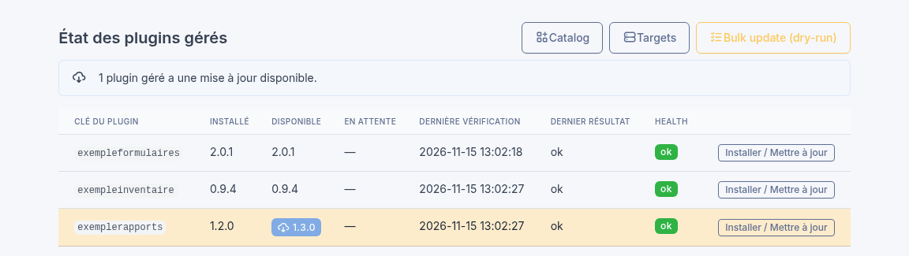
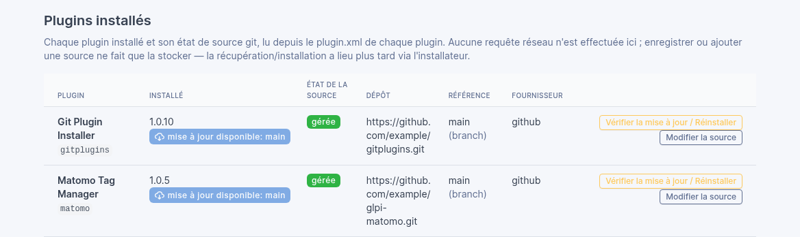
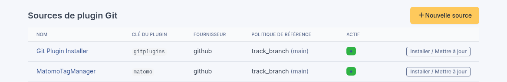
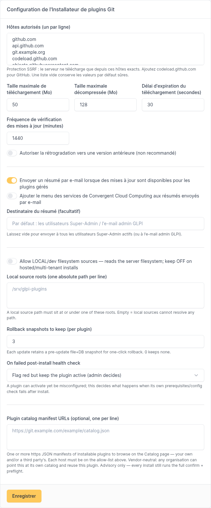
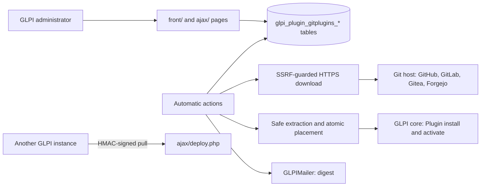

# Git Plugin Installer — install and update GLPI plugins from a git repository

[Français](README.md) · **English**

[](https://www.gnu.org/licenses/gpl-2.0.html)
[](https://glpi-project.org)
[](https://www.php.net/)



> A GLPI 11 meta-plugin that installs and updates other plugins from a git/HTTPS source (GitHub,
> GitLab, Gitea, Forgejo), for plugins that are not on the official marketplace. It is for GLPI
> administrators who want verified updates, reversible in one click, without copying files by hand.

It **extends** GLPI's native pipeline rather than replacing it: it owns a hardened fetch and
extraction step, then calls core's `Plugin::install()` and `Plugin::activate()`, so managed plugins
behave like marketplace ones (their own install hooks run).

> **Warning.** Installing a plugin runs that plugin's install code on the server, with the web
> server user's rights. Only register sources you trust. The risk is detailed in
> [docs/SECURITE.md](docs/SECURITE.md) (in French).

## Features

- **Managed git sources**: a repository URL, a **ref policy** (track a branch, latest tag, pinned
  tag, pinned SHA, or a prebuilt release `.tgz`) and, for a private repository, a token encrypted
  with GLPI's key. Each source belongs to an entity.
- **Detect from URL**: the plugin reads the repository's `plugin.xml` and pre-fills the key, name and
  declared ref (the `<gitupdate>` block).
- **Installed-plugins discovery**: lists the plugins on disk and offers to install, update or
  reinstall them, or to register their origin as a managed source. Marketplace-managed plugins are
  excluded.
- **HTTPS archive download**, no `git` binary: no `.git` directory ever lands in `plugins/`.
- **Confirm before install**: resolved source, ref and SHA, installed against available version,
  environment preflight, known issues and the changelog. A notice says the target's code will run.
  Installs run **outside the web request**, in a resumable cron task.
- **Update badge and email digest**: an hourly check feeds the badge; a daily task sends a digest,
  only when the list of available updates changes.
- **Verified pipeline**: environment preflight, optional `composer`/`npm` build, translation
  compile, atomic placement, pre-migration database snapshot, post-install verification. A failed
  migration leaves the previous version active (files and schema).
- **One-click rollback**: each update keeps an inert file backup and a snapshot of the plugin's
  tables (the last three by default).
- **Health gate and hook-collision detector**, **known-issues registry**.
- **Bulk update** with a non-mutating dry-run.
- **Plugin catalog**: browse one or more vendor-neutral JSON manifests and pre-fill a source.
- **Local source** (an allowlisted disk path, off by default).
- **Multi-target deploy, pull model**: serves a read-only, HMAC-signed, SHA-pinned manifest that
  other GLPI instances fetch. No endpoint executes received code.
- Interface in French and English.

## Requirements

| Component | Version |
|---|---|
| GLPI | 11.0.x (minimum 11.0.0, maximum 11.99.99) |
| PHP | 8.2 or later |
| GLPI automatic actions | running (system cron required) |
| `composer`, `npm` binaries | optional: only to build a source that needs it |
| Outbound network | HTTPS to the allowlisted hosts (GitHub and GitLab by default), through GLPI's proxy if any |

No dependency on another plugin: it reuses the HTTP client and proxy configured in GLPI.

## Installation

The plugin directory **must** be named `gitplugins`. Full procedure:
[docs/ADMINISTRATION.en.md](docs/ADMINISTRATION.en.md).

```bash
cd <glpi>/plugins
git clone https://github.com/FathiBenNasr/gitplugins.git gitplugins
cd <glpi>
sudo -u www-data php bin/console plugin:install gitplugins
sudo -u www-data php bin/console plugin:activate gitplugins
sudo -u www-data php bin/console cache:clear
```

GLPI's **system cron** is required: the update check, the deferred install and the digest are
automatic actions.

```cron
* * * * * php <glpi>/front/cron.php
```

Never run GLPI's console as `root`. Every version bump requires running `plugin:install gitplugins`
then `plugin:activate gitplugins` again, otherwise GLPI sees a code/database mismatch, deactivates
the plugin and its pages answer 404. Once installed, the plugin can update **itself** from its own
source.

## Configuration

**Setup → Git Plugin Installer → Configuration** (right `plugin_gitplugins` at update level).
Details: [docs/ADMINISTRATION.en.md](docs/ADMINISTRATION.en.md#configuration).

| Setting | Default | Effect |
|---|---|---|
| Allowed hosts | GitHub, its download hosts, GitLab | SSRF allowlist: the server only downloads from these exact hosts |
| Max download size | 50 MB (1–500) | archive cap |
| Max unpacked size | 128 MB (16–1024) | cap on the total unpacked size |
| Fetch timeout | 30 s (5–300) | network timeout |
| Update-check frequency | 1440 min (5–40320) | cadence of the check |
| Allow automatic (unattended) install on update | off | leave off to confirm before installing |
| Allow downgrading | off | downgrades are refused unless enabled |
| Email digest | on | message when updates are available |
| Digest recipient | empty | otherwise active Super-Admins, then GLPI's administration address |
| Allow local/dev sources | off | reads the server disk; keep off on shared hosting |
| Rollback snapshots to keep | 3 (0–50) | backups retained per plugin |
| On failed post-install health check | flag red | or automatically roll back |
| Plugin catalog manifest URLs | empty | https JSON manifests, one per line |

## Usage

Menu **Setup → Git Plugin Installer**.

1. **Add a source**: **New source**, paste the repository https URL, click **Detect**, check the
   plugin key and the ref policy, **Save**.
2. **Install or update**: **Install / Update**, **Review install / update**, read the ref, the SHA and
   the preflight, then confirm. The action is queued; the cron task downloads, extracts, places and
   installs.
3. **Follow up**: the **Status** screen shows versions, the last check and health.
4. **Roll back**: the **Rollback** control on the plugin's row restores the previous version (files
   and tables).

The illustrated walk-through is in [docs/GUIDE.en.md](docs/GUIDE.en.md); the complete user manual is
[docs/MANUEL.en.md](docs/MANUEL.en.md).

## Screenshots

| Installed plugins | Sources | Configuration |
|---|---|---|
| [](docs/captures/02-installed.png) | [](docs/captures/03-sources.png) | [](docs/captures/05-config.png) |

Images generated by the browser bench on fictitious data: what each one shows and the command that
regenerates them are in [docs/captures/README.md](docs/captures/README.md) (in French).

## Architecture



The plugin writes only to its `glpi_plugin_gitplugins_*` tables (and its right in
`glpi_profilerights`) and only **reads** `glpi_plugins`. Details:
[docs/ARCHITECTURE.md](docs/ARCHITECTURE.md) (in French); data model: [docs/SCHEMA.md](docs/SCHEMA.md).

## Security

Installing remote code is a **supply-chain** surface. The controls follow the OWASP Top 10 and ASVS
level 2: SSRF guard (HTTPS only, allowlist, private addresses refused, re-validation on every
redirect), extraction hardened against zip-slip and archive bombs, moved-tag detection, encrypted
token, a right reserved to profiles that can already change the configuration, audit log. **The
plugin verifies no signature of the upstream code**: trust rests on the choice of the source and on
the human confirmation. Only one entry point is anonymous (`ajax/deploy.php`), protected by HMAC.
See [docs/SECURITE.md](docs/SECURITE.md) (in French) and [SECURITY.md](SECURITY.md) to report a
vulnerability.

## Tests

```bash
php tests/run.php
```

290 tests (pure logic, core stubs, mutations from the 24 October 2026 audit in `tests/mutations/`).
Where PHPUnit is installed, `phpunit tests/` runs the same files.

## Troubleshooting

| Symptom | Likely cause | Fix |
|---|---|---|
| Pages return 404 after an update | version not reinstalled, GLPI deactivated the plugin | `plugin:install gitplugins` then `plugin:activate gitplugins` |
| The menu does not appear | the profile lacks the `plugin_gitplugins` right | grant it in Administration → Profiles, then log in again |
| "Host … is not in the allowed-hosts list" | the repository host is not on the allowlist | add it in Configuration → Allowed hosts |
| After "Queued", nothing changes | GLPI's cron is not running | check the system cron entry and **Setup → Automatic actions** |
| "This plugin is managed by the GLPI marketplace" | the plugin comes from the official marketplace | update it from the marketplace |

## Changelog

See [CHANGELOG.md](CHANGELOG.md).

## License

GPL-2.0-or-later (SPDX identifier), see [LICENSE](LICENSE). © 2026 Convergent Cloud Computing.
Contact: contact@convergent.tn.

---

<div align="center">

**[Convergent Cloud Computing](https://www.convergent.tn)** — cloud infrastructure, open-source
integration and cybersecurity for Tunisian and international businesses.

contact@convergent.tn · [www.convergent.tn](https://www.convergent.tn)

</div>
