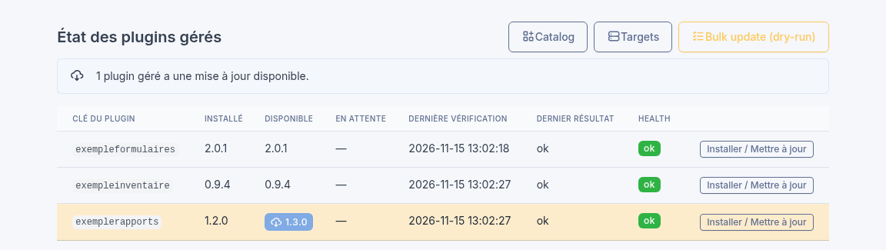
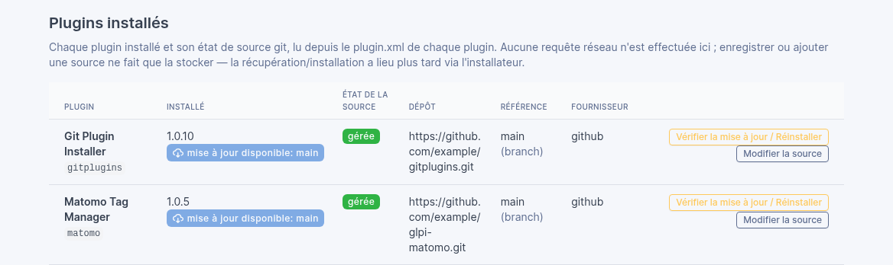
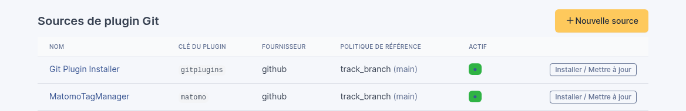
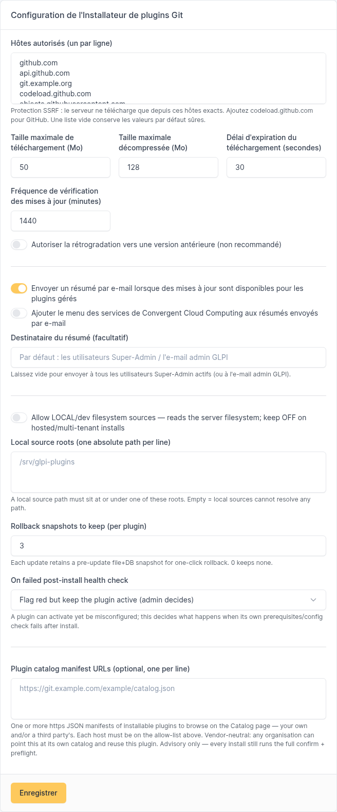
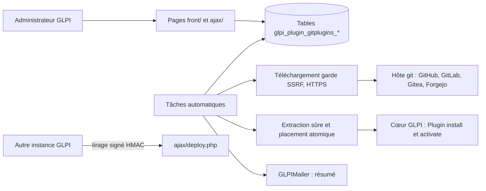

# Git Plugin Installer — installer et mettre à jour des greffons GLPI depuis un dépôt git

**Français** · [English](README.en.md)

[](https://www.gnu.org/licenses/gpl-2.0.html)
[](https://glpi-project.org)
[](https://www.php.net/)



> Méta-greffon GLPI 12 qui installe et met à jour d'autres greffons depuis une source git en
> HTTPS (GitHub, GitLab, Gitea, Forgejo), pour les greffons absents du catalogue officiel. Il
> s'adresse aux administrateurs de GLPI qui veulent des mises à jour vérifiées, annulables en un
> clic, sans copier des fichiers à la main.

Il **prolonge** le mécanisme natif de GLPI au lieu de le remplacer : il se charge du téléchargement
et de l'extraction, durcis, puis appelle `Plugin::install()` et `Plugin::activate()` du cœur, de sorte
que les greffons gérés se comportent comme ceux du catalogue (leurs propres crochets
d'installation s'exécutent).

> **Avertissement.** Installer un greffon exécute le code d'installation de ce greffon sur le
> serveur, avec les droits de l'utilisateur du serveur web. Ne déclarez que des sources de
> confiance. Le risque est détaillé dans [docs/SECURITE.md](docs/SECURITE.md).

## Fonctionnalités

- **Sources git gérées** : une URL de dépôt, une **politique de référence** (suivre une branche,
  dernier tag, tag épinglé, SHA épinglé, ou archive `.tgz` de version déjà construite) et, pour un
  dépôt privé, un jeton chiffré par la clé de GLPI. Chaque source appartient à une entité.
- **Détection depuis l'URL** : le greffon lit le `plugin.xml` du dépôt et préremplit la clé, le nom
  et la référence déclarée (bloc `<gitupdate>`).
- **Découverte des plugins installés** : liste les greffons présents sur le disque et propose de les
  installer, de les mettre à jour, de les réinstaller ou d'enregistrer leur origine comme source
  gérée. Les greffons gérés par le catalogue de GLPI sont exclus.
- **Téléchargement d'archive en HTTPS**, sans binaire `git` : aucun dossier `.git` n'arrive dans
  `plugins/`.
- **Confirmation avant installation** : source, référence et SHA résolus, version installée contre
  version disponible, contrôle d'environnement, problèmes connus et journal des modifications. Une
  mention rappelle que le code de la cible s'exécute. L'installation se fait **hors de la requête
  web**, par une tâche automatique reprenable.
- **Pastille de mise à jour et résumé par courriel** : une vérification horaire alimente la pastille ;
  une tâche quotidienne envoie un résumé, seulement quand la liste des mises à jour change.
- **Pipeline vérifié** : contrôle d'environnement, build `composer`/`npm` facultatif, compilation
  des traductions, placement atomique, instantané de la base avant migration, vérification après
  installation. Une migration qui échoue laisse la version précédente active (fichiers et schéma).
- **Retour arrière en un clic** : chaque mise à jour garde une sauvegarde inerte et un instantané des
  tables du greffon (les trois derniers par défaut).
- **Contrôle de santé et détecteur de collisions de crochets**, **registre de problèmes connus**.
- **Mise à jour groupée** avec simulation (*dry-run*) qui ne modifie rien.
- **Catalogue** de greffons : parcourir un ou plusieurs manifestes JSON neutres et préremplir une
  source.
- **Source locale** (chemin du disque dans une liste blanche, désactivée par défaut).
- **Déploiement multicible en mode tirage** : sert un manifeste en lecture seule, signé (HMAC) et
  épinglé par SHA, que d'autres instances GLPI viennent chercher. Aucun point d'entrée n'exécute de
  code reçu.
- Interface en français et en anglais.

## Prérequis

| Composant | Version |
|---|---|
| GLPI | 12.0.x (minimum 12.0.0, maximum 12.99.99) — GLPI 11 : branche `glpi-11-12` (1.0.x) |
| PHP | 8.2 ou plus |
| Tâches automatiques de GLPI | actives (cron système requis) |
| Binaires `composer`, `npm` | facultatifs : seulement pour la construction d'une source qui l'exige |
| Sortie réseau | HTTPS vers les hôtes de la liste blanche (GitHub et GitLab par défaut), via le mandataire de GLPI s'il y en a un |

Aucune dépendance vis-à-vis d'un autre greffon : le greffon réutilise le client HTTP et le
mandataire configurés dans GLPI.

## Installation

Le dossier du greffon **doit** s'appeler `gitplugins`. Procédure complète :
[docs/ADMINISTRATION.md](docs/ADMINISTRATION.md).

```bash
cd <glpi>/plugins
git clone https://github.com/FathiBenNasr/gitplugins.git gitplugins
cd <glpi>
sudo -u www-data php bin/console plugin:install gitplugins
sudo -u www-data php bin/console plugin:activate gitplugins
sudo -u www-data php bin/console cache:clear
```

Le **cron système** de GLPI est indispensable : la vérification des mises à jour, l'installation
différée et le résumé sont des tâches automatiques.

```cron
* * * * * php <glpi>/front/cron.php
```

Ne lancez jamais la console de GLPI en `root`. Chaque montée de version impose de rejouer
`plugin:install gitplugins` puis `plugin:activate gitplugins`, sinon GLPI voit un écart entre le code
et la base, désactive le greffon et ses pages répondent 404. Une fois installé, le greffon peut se
mettre à jour **lui-même** depuis sa propre source.

## Configuration

Page **Configuration → Installateur de plugins Git → Configuration** (droit `plugin_gitplugins` en mise à
jour). Détail : [docs/ADMINISTRATION.md](docs/ADMINISTRATION.md#configuration).

| Réglage | Défaut | Effet |
|---|---|---|
| Hôtes autorisés | GitHub, ses hôtes de téléchargement, GitLab | liste blanche anti-SSRF : le serveur ne télécharge que depuis ces hôtes exacts |
| Taille maximale de téléchargement | 50 Mo (1–500) | plafond de l'archive |
| Taille maximale décompressée | 128 Mo (16–1024) | plafond du total décompressé |
| Délai d'expiration du téléchargement | 30 s (5–300) | délai réseau |
| Fréquence de vérification des mises à jour | 1440 min (5–40320) | cadence de la vérification |
| Rétrogradation vers une version antérieure | désactivée | refusée tant que le réglage n'est pas activé |
| Résumé par courriel | activé | message quand des mises à jour sont disponibles |
| Destinataire du résumé | vide | à défaut : les Super-Admin actifs, puis l'adresse d'administration de GLPI |
| Sources locales | désactivées | lit le disque du serveur ; laisser désactivé sur un hébergement partagé |
| Instantanés de retour arrière à conserver | 3 (0–50) | sauvegardes conservées par greffon |
| Action si le contrôle de santé échoue | signaler en rouge | ou revenir automatiquement à la version précédente |
| URL du catalogue | vide | manifestes JSON (https), un par ligne |

## Utilisation

Menu **Configuration → Installateur de plugins Git** (le nom du greffon dans l'interface française).

1. **Ajouter une source** : **Nouvelle source**, coller l'URL https du dépôt, cliquer **Détecter**,
   vérifier la clé du plugin et la politique de référence, **Enregistrer**.
2. **Installer ou mettre à jour** : **Installer / Mettre à jour**, **Examiner l'installation / la mise
   à jour**, lire la référence, le SHA et le contrôle d'environnement, puis confirmer. L'action est
   mise en file ; la tâche automatique télécharge, extrait, place et installe.
3. **Suivre** : l'écran **État** montre les versions, la dernière vérification et la santé.
4. **Revenir en arrière** : le bouton **Rollback** de la ligne du greffon restaure la version
   précédente (fichiers et tables).

Le pas-à-pas illustré est dans [docs/GUIDE.md](docs/GUIDE.md) ; le manuel utilisateur complet dans
[docs/MANUEL.md](docs/MANUEL.md).

## Captures

| Plugins installés | Sources | Configuration |
|---|---|---|
| [](docs/captures/02-installed.png) | [](docs/captures/03-sources.png) | [](docs/captures/05-config.png) |

Images engendrées par le banc navigateur sur des données fictives : ce que montre chacune et la
commande qui les refait sont dans [docs/captures/README.md](docs/captures/README.md).

## Architecture



Le greffon n'écrit que dans ses tables `glpi_plugin_gitplugins_*` (et ses droits dans
`glpi_profilerights`) et ne fait que **lire** `glpi_plugins`. Détail :
[docs/ARCHITECTURE.md](docs/ARCHITECTURE.md) ; modèle de données : [docs/SCHEMA.md](docs/SCHEMA.md).

## Sécurité

Installer du code distant est une surface de **chaîne d'approvisionnement**. Les contrôles suivent
l'OWASP Top 10 et l'ASVS niveau 2 : garde SSRF (HTTPS seul, liste blanche, adresses privées refusées,
revalidation à chaque redirection), extraction protégée contre le zip-slip et les bombes
d'archives, détection d'un tag déplacé, jeton chiffré, droit réservé aux profils qui peuvent déjà
modifier la configuration, journal d'audit. **Le greffon ne vérifie aucune signature du code
amont** : la confiance repose sur le choix de la source et sur la confirmation humaine. Un seul
point d'entrée est anonyme (`ajax/deploy.php`), protégé par HMAC. Voir
[docs/SECURITE.md](docs/SECURITE.md) et [SECURITY.md](SECURITY.md) pour signaler une vulnérabilité.

## Tests

```bash
php tests/run.php
```

290 tests (logique pure, bouchons du cœur, mutations de l'audit du 24 octobre 2026 dans
`tests/mutations/`). Sur une machine où PHPUnit est installé, `phpunit tests/` lance les mêmes
fichiers.

## Dépannage

| Symptôme | Cause probable | Remède |
|---|---|---|
| Pages en 404 après une mise à jour | version non réinstallée, GLPI a désactivé le greffon | `plugin:install gitplugins` puis `plugin:activate gitplugins` |
| Le menu n'apparaît pas | le profil n'a pas le droit `plugin_gitplugins` | l'accorder dans Administration → Profils, puis se reconnecter |
| « Host … is not in the allowed-hosts list » | l'hôte du dépôt n'est pas dans la liste blanche | l'ajouter dans Configuration → Hôtes autorisés |
| Après « Queued », rien ne change | le cron de GLPI ne tourne pas | vérifier la tâche cron système et **Configuration → Actions automatiques** |
| « This plugin is managed by the GLPI marketplace » | le greffon vient du catalogue officiel | le mettre à jour depuis le catalogue |

## Historique

Voir [CHANGELOG.md](CHANGELOG.md).

## Licence

GPL-2.0-or-later (identifiant SPDX), voir [LICENSE](LICENSE). © 2026 Convergent Cloud Computing.
Contact : contact@convergent.tn.

---

<div align="center">

**[Convergent Cloud Computing](https://www.convergent.tn)** — infrastructure cloud, intégration de
logiciels libres et cybersécurité pour les entreprises tunisiennes et internationales.

contact@convergent.tn · [www.convergent.tn](https://www.convergent.tn)

</div>
