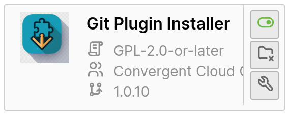
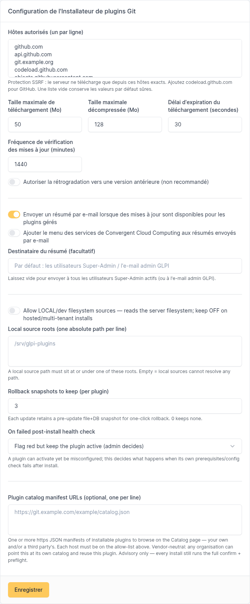

# Administration — Git Plugin Installer

[Français](ADMINISTRATION.md) · **English**

To install, configure, operate and troubleshoot Git Plugin Installer (GLPI 11.0.x, PHP 8.2 or later).
Paths use `<glpi>` for GLPI's root.

## Installation

### Where Git Plugin Installer lives

| Location | Path | Role |
|---|---|---|
| Source | local repository `GLPI/gitplugins`, branch `glpi-11-12` | development, tests |
| Test production | `<glpi>/plugins/gitplugins/` of the test instance | validation before release |
| Forgejo | `https://git.convergent.tn/fbennasr/GLPI-gitplugins` | reference repository |

The deployed directory **must** be named `gitplugins` (the plugin key); the repository name
(`GLPI-gitplugins`) differs from the directory. The three copies normally diverge: never align one
by deleting files.



### Procedure

1. Copy the repository (or the release archive) into `<glpi>/plugins/gitplugins/`; the files belong
   to the web server user.
2. If SELinux is active: `restorecon -R <glpi>/plugins/gitplugins`.
3. Install and activate, **as the web server user, never as root**:

```bash
cd <glpi>
sudo -u www-data php bin/console plugin:install gitplugins
sudo -u www-data php bin/console plugin:activate gitplugins
sudo -u www-data php bin/console cache:clear
```

4. On install, the `plugin_gitplugins` right is granted **only** to profiles that already hold the
   right to update GLPI's configuration (`config`, update). Logged-in administrators log in again to
   see the menu. A reinstall only grants it to profiles that never had it: a revocation survives.
5. Check that GLPI's **system cron** is running: without it nothing downloads and no check happens.

```cron
* * * * * php <glpi>/front/cron.php
```

## Configuration

**Setup → Git Plugin Installer → Configuration** page (`front/config.php`), reserved to those with the
`plugin_gitplugins` right at update level. Settings apply to the whole instance and live in the
single-row table `glpi_plugin_gitplugins_config`. They take effect immediately, no restart.



### Settings

| Setting (label) | Default | Effect |
|---|---|---|
| **Allowed hosts** | `github.com`, `api.github.com`, `raw.githubusercontent.com`, `codeload.github.com`, `objects.githubusercontent.com`, `github-releases.githubusercontent.com`, `gitlab.com` | SSRF allowlist, one exact host per line. An empty list is refused: the defaults are kept. For a self-hosted Forgejo or Gitea, add its host. |
| **Max download size (MB)** | 50 (1–500) | cap on the downloaded archive |
| **Max unpacked size (MB)** | 128 (16–1024) | cap on the total unpacked size |
| **Fetch timeout (seconds)** | 30 (5–300) | network timeout |
| **Update-check frequency (minutes)** | 1440 (5–40320) | cadence of the update check |
| **Allow automatic (unattended) install on update** | off | leave off (to be verified: see [Known gaps](SECURITE.md#écarts-connus), in French) |
| **Allow downgrading to an older version** | off | an older version is refused otherwise |
| **Email a digest when managed plugins have updates available** | on | sends the digest |
| **Append the Convergent Cloud Computing services menu to digest emails** | off | appends a menu of publisher links at the end of the digest; a link outside its domains removes the whole menu |
| **Digest recipient (optional)** | empty | otherwise active Super-Admins, then GLPI's administration address |
| **Allow LOCAL/dev filesystem sources** | off | reads the server disk; keep off on shared hosting |
| **Local source roots (one absolute path per line)** | empty | path allowlist; empty, no local source resolves |
| **Rollback snapshots to keep (per plugin)** | 3 (0–50) | backups kept per plugin; 0 keeps none |
| **On failed post-install health check** | flag red | or automatically roll back to the previous version |
| **Plugin catalog manifest URLs (optional, one per line)** | empty | https JSON manifests whose host is on the allowlist |

Four settings of the table have no field on the screen and keep their default: directories carried
over between versions (`vendor`, `node_modules`), automatic cache clearing after activation (on),
`composer`/`npm` build timeout (300 s) and maximum database snapshot size (100 MB).

### Rights

A single right, **`plugin_gitplugins`**, set in **Administration → Profiles**.

| Level | What it allows |
|---|---|
| Read | see the sources, the installed plugins, the status, the update plan, the catalog and the targets |
| Update | create and edit sources, queue an install, bulk update, roll back, change the configuration, manage the catalog and the targets |
| Delete (purge) | remove a source or a target |

Sources are attached to an entity: you only act on those in your entities.

## Operations

### Automatic actions

Visible in **Setup → Automatic actions**, under "Git plugin update check":

| Task | Role | Default frequency |
|---|---|---|
| `checkUpdates` | checks the active sources, updates the **Status** screen and runs pending installs | every hour |
| `notifyUpdates` | sends the email digest, only if the list of updates changed | once a day |
| `applyUpdates` | applies the installs queued by the bulk update | every 15 minutes |

All three accept web cron and command-line cron. The digest goes through GLPI's mail framework
(`GLPIMailer`), with the core's sender (`Config::getEmailSender()`); the administration address is
only ever a recipient.

### Logs

- **The plugin's audit log**: table `glpi_plugin_gitplugins_logs` (every download, install and update,
  with the user, the ref and the SHA). Generic messages, no secret. **Kept one year**, purged by the
  automatic action.
- **GLPI's event log**: the same actions are recorded there.
- **GLPI logs** in `/var/log/glpi` (or the configured directory) for PHP errors.

### Backups and snapshots

Each update keeps, outside the web tree, an inert `.zip` archive
(`<GLPI_VAR_DIR>/_gitplugins/backups`, directory `0700`, files `0600`) and a snapshot of the target
plugin's tables (`<GLPI_VAR_DIR>/_dump`, to be checked on your installation). They are restored with
**Rollback** (see the [guide](GUIDE.en.md#rolling-back-to-a-previous-version)). Back up
`<GLPI_VAR_DIR>/_gitplugins` with the rest of `<GLPI_VAR_DIR>`: these archives are the return points.

### Monitoring

The **Status** screen is the monitoring: the **Last result** column and the health (*Health*) say
whether the last install succeeded. Also watch that the three automatic actions run. There is no
plugin-specific alert, apart from the email digest.

## Upgrade and uninstall

**Upgrading the plugin.** Copying the new files is not enough: run `plugin:install gitplugins` then
`plugin:activate gitplugins` again, otherwise GLPI sees a code/database mismatch, deactivates the
plugin and its pages answer 404. Version 1.0.4 added the `glpi_plugin_gitplugins_deploy_nonces`
table and two columns, created by that reinstall; versions 1.0.8 and 1.0.9 add columns. The plugin
can also update itself from its own source. Each version is described in
[CHANGELOG.md](../CHANGELOG.md).

**Uninstalling.** `plugin:uninstall gitplugins` removes the automatic actions and the right, deletes
the retained snapshots and the plugin's tables, **except** the audit table: it is renamed to a dated
archive, because the proof of what was installed must outlive the plugin. Plugins installed through
it stay in place.

## Troubleshooting

| Symptom | Diagnosis | Fix |
|---|---|---|
| Pages return 404 after an update | `sudo -u www-data php bin/console plugin:list`: the plugin is inactive | `plugin:install gitplugins --force` then `plugin:activate gitplugins`, then `cache:clear` |
| The menu does not appear | the profile lacks the right | grant it in Administration → Profiles, then log in again |
| "Host … is not in the allowed-hosts list" | the repository host is not listed | add it to **Allowed hosts** |
| After "Queued", nothing changes | the **Pending** column stays filled: the cron is not running | check the system cron and the `checkUpdates` and `applyUpdates` automatic actions |
| "This plugin is managed by the GLPI marketplace" | a copy from the official marketplace exists | update it from the marketplace |
| "This plugin key is already managed by another source" | a plugin has a single source | edit the existing source |
| Health red (*fail*) after an install | the plugin fails its own prerequisites or configuration check | read the audit log, then **Rollback** to the previous version |
| No backup offered | the number kept is 0, or no update has happened | set **Rollback snapshots to keep** |
| No email digest | the setting is off, or the list has not changed since the last sending | check the setting and the recipient |
| Install refused "tag_moved" | the installed tag now points to other content | publish a new tag; do not force it without understanding why |
