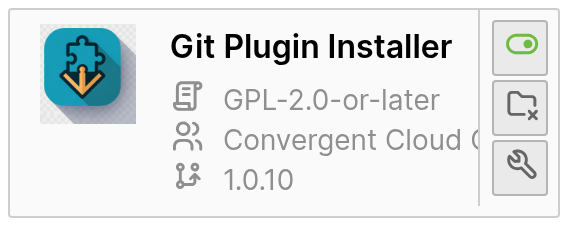
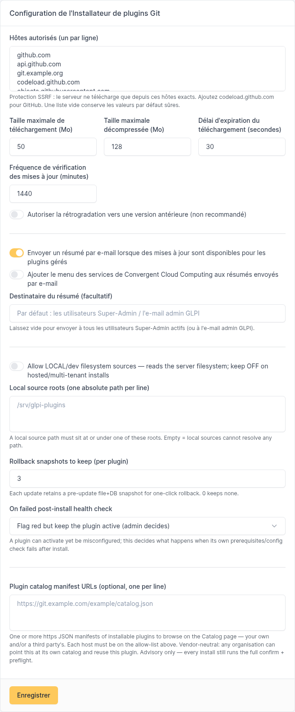

# Administration — Git Plugin Installer

**Français** · [English](ADMINISTRATION.en.md)

Pour installer, configurer, exploiter et dépanner Git Plugin Installer (GLPI 12.0.x — la ligne GLPI 11 est la branche `glpi-11-12` —, PHP 8.2 ou
plus). Les chemins utilisent `<glpi>` pour la racine de GLPI.

## Installation

### Où vit Git Plugin Installer

| Emplacement | Chemin | Rôle |
|---|---|---|
| Source | dépôt local `GLPI/gitplugins`, branche `glpi-12` (1.1.x) | développement, tests |
| Production-test | `<glpi>/plugins/gitplugins/` de l'instance de test | validation avant diffusion |
| Forgejo | `https://git.convergent.tn/fbennasr/GLPI-gitplugins` | dépôt de référence |

Le dossier déployé **doit** s'appeler `gitplugins` (clé du greffon) ; le nom du dépôt
(`GLPI-gitplugins`) diffère du dossier. Les trois exemplaires divergent normalement : ne jamais en
aligner un en supprimant des fichiers.



### Procédure

1. Copier le dépôt (ou l'archive de version) dans `<glpi>/plugins/gitplugins/` ; le propriétaire des
   fichiers est l'utilisateur du serveur web.
2. Si SELinux est actif : `restorecon -R <glpi>/plugins/gitplugins`.
3. Installer et activer, **en tant qu'utilisateur du serveur web, jamais en root** :

```bash
cd <glpi>
sudo -u www-data php bin/console plugin:install gitplugins
sudo -u www-data php bin/console plugin:activate gitplugins
sudo -u www-data php bin/console cache:clear
```

4. À l'installation, le droit `plugin_gitplugins` est accordé **uniquement** aux profils qui ont déjà
   le droit de mettre à jour la configuration de GLPI (`config`, mise à jour). Les administrateurs
   connectés se reconnectent pour voir le menu. Une réinstallation ne l'accorde qu'aux profils qui ne
   l'ont jamais eu : une révocation survit.
5. Vérifier que le **cron système** de GLPI tourne : sans lui, rien ne se télécharge et aucune
   vérification n'a lieu.

```cron
* * * * * php <glpi>/front/cron.php
```

## Configuration

Page **Configuration → Installateur de plugins Git → Configuration** (`front/config.php`), réservée
à qui a le droit `plugin_gitplugins` en mise à jour. Les réglages valent pour toute l'instance et sont
dans la table à ligne unique `glpi_plugin_gitplugins_config`. Ils prennent effet immédiatement, sans
redémarrage.



### Réglages

| Réglage (libellé anglais) | Défaut | Effet |
|---|---|---|
| **Allowed hosts** | `github.com`, `api.github.com`, `raw.githubusercontent.com`, `codeload.github.com`, `objects.githubusercontent.com`, `github-releases.githubusercontent.com`, `gitlab.com` | liste blanche anti-SSRF, un hôte exact par ligne. Une liste vide est refusée : les valeurs par défaut sont conservées. Pour un Forgejo ou un Gitea auto-hébergé, ajoutez son hôte. |
| **Max download size (MB)** | 50 (1–500) | plafond de l'archive téléchargée |
| **Max unpacked size (MB)** | 128 (16–1024) | plafond du total décompressé |
| **Fetch timeout (seconds)** | 30 (5–300) | délai réseau |
| **Update-check frequency (minutes)** | 1440 (5–40320) | cadence de la vérification des mises à jour |
| **Allow downgrading to an older version** | désactivé | une version plus ancienne est refusée sinon |
| **Email a digest when managed plugins have updates available** | activé | envoi du résumé |
| **Append the Convergent Cloud Computing services menu to digest emails** | désactivé | ajoute un menu de liens du fournisseur à la fin du résumé ; tout lien hors de ses domaines supprime le menu entier |
| **Digest recipient (optional)** | vide | à défaut : les Super-Admin actifs, puis l'adresse d'administration de GLPI |
| **Allow LOCAL/dev filesystem sources** | désactivé | lit le disque du serveur ; laisser désactivé sur un hébergement partagé |
| **Local source roots (one absolute path per line)** | vide | liste blanche de chemins ; vide, aucune source locale ne se résout |
| **Rollback snapshots to keep (per plugin)** | 3 (0–50) | sauvegardes conservées par plugin ; 0 n'en garde aucune |
| **On failed post-install health check** | signaler en rouge | ou revenir automatiquement à la version précédente |
| **Plugin catalog manifest URLs (optional, one per line)** | vide | manifestes JSON en https, dont l'hôte est dans la liste blanche |

Quatre réglages de la table n'ont pas de champ dans l'écran et gardent leur valeur par défaut :
dossiers conservés d'une version à l'autre (`vendor`, `node_modules`), nettoyage automatique des
caches après activation (activé), délai des constructions `composer`/`npm` (300 s) et taille maximale
de l'instantané de base (100 Mo).

### Droits

Un seul droit, **`plugin_gitplugins`**, à régler dans **Administration → Profils**.

| Niveau | Ce qu'il permet |
|---|---|
| Lecture | voir les sources, les plugins installés, l'état, le plan de mise à jour, le catalogue et les cibles |
| Mise à jour | créer et modifier des sources, mettre une installation en file, mettre à jour en groupe, revenir en arrière, changer la configuration, gérer le catalogue et les cibles |
| Suppression (purge) | retirer une source ou une cible |

Les sources sont rattachées à une entité : on n'agit que sur celles de ses entités.

## Exploitation

### Tâches automatiques

Visibles dans **Configuration → Actions automatiques**, sous « Vérification des mises à jour des
plugins Git » :

| Tâche | Rôle | Fréquence par défaut |
|---|---|---|
| `checkUpdates` | vérifie les sources actives, met à jour l'écran **État** et exécute les installations en attente | toutes les heures |
| `notifyUpdates` | envoie le résumé par courriel, seulement si la liste des mises à jour a changé | une fois par jour |
| `applyUpdates` | applique les installations mises en file par la mise à jour groupée | tous les quarts d'heure |

Les trois acceptent le cron web et le cron en ligne de commande. Le résumé part par le cadre d'envoi
de GLPI (`GLPIMailer`), avec l'expéditeur du cœur (`Config::getEmailSender()`) ; l'adresse
d'administration n'est que destinataire.

### Journaux

- **Journal d'audit du greffon** : table `glpi_plugin_gitplugins_logs` (chaque téléchargement,
  installation, mise à jour, avec l'utilisateur, la référence et le SHA). Messages génériques, sans
  secret. **Conservation d'un an**, purge par la tâche automatique.
- **Journal des événements de GLPI** : les mêmes actions y sont inscrites.
- **Journaux de GLPI** dans `/var/log/glpi` (ou le dossier configuré) pour les erreurs PHP.

### Sauvegardes et instantanés

Chaque mise à jour garde, hors de l'arborescence web, une archive `.zip` inerte
(`<GLPI_VAR_DIR>/_gitplugins/backups`, dossier en `0700`, fichiers en `0600`) et un instantané des
tables du greffon cible (`<GLPI_VAR_DIR>/_dump`, à vérifier sur votre installation). On les restaure
par **Rollback** (voir le [guide](GUIDE.md#revenir-à-une-version-précédente)). Sauvegardez
`<GLPI_VAR_DIR>/_gitplugins` avec le reste de `<GLPI_VAR_DIR>` : ces archives sont les points de retour.

### Supervision

L'écran **État** est la supervision : la colonne **Dernier résultat** et la santé (*Health*) disent
si la dernière installation a réussi. Surveillez aussi l'exécution des trois tâches automatiques.
Aucune alerte propre au greffon, hors le résumé par courriel.

## Mise à jour et désinstallation

**Mise à jour du greffon.** Copier les nouveaux fichiers ne suffit pas : rejouer
`plugin:install gitplugins` puis `plugin:activate gitplugins`, sinon GLPI voit un écart entre le code
et la base, désactive le greffon et ses pages répondent 404. La version 1.0.4 a ajouté la table
`glpi_plugin_gitplugins_deploy_nonces` et deux colonnes, créées par cette réinstallation ; les
versions 1.0.8 et 1.0.9 ajoutent des colonnes. Le greffon peut aussi se mettre à jour lui-même
depuis sa source. Chaque version est décrite dans [CHANGELOG.md](../CHANGELOG.md).

**Désinstallation.** `plugin:uninstall gitplugins` retire les tâches automatiques et le droit,
supprime les instantanés conservés et les tables du greffon, **sauf** la table d'audit : elle est
renommée en archive datée, car la preuve de ce qui a été installé doit survivre au greffon. Les
plugins installés par son moyen restent en place.

## Dépannage

| Symptôme | Diagnostic | Remède |
|---|---|---|
| Pages en 404 après une mise à jour | `sudo -u www-data php bin/console plugin:list` : le greffon est inactif | `plugin:install gitplugins --force` puis `plugin:activate gitplugins`, puis `cache:clear` |
| Le menu n'apparaît pas | le profil n'a pas le droit | l'accorder dans Administration → Profils, puis se reconnecter |
| « L'hôte … n'est pas dans la liste des hôtes autorisés » | l'hôte du dépôt n'est pas listé | l'ajouter dans **Allowed hosts** |
| Après « Mis en file », rien ne change | la colonne **En attente** reste remplie : le cron ne tourne pas | vérifier le cron système et les actions automatiques `checkUpdates` et `applyUpdates` |
| « Ce plugin est géré par la marketplace GLPI » | une copie du catalogue officiel existe | mettre à jour depuis le catalogue |
| « Cette clé de greffon est déjà gérée par une autre source » | un plugin n'a qu'une source | modifier la source existante |
| Santé en rouge (*fail*) après une installation | le plugin échoue à son propre contrôle de prérequis ou de configuration | consulter le journal d'audit, puis **Rollback** vers la version précédente |
| Aucune sauvegarde proposée | le nombre conservé est à 0, ou aucune mise à jour n'a eu lieu | régler **Rollback snapshots to keep** |
| Pas de résumé par courriel | le réglage est désactivé, ou la liste n'a pas changé depuis le dernier envoi | contrôler le réglage et le destinataire |
| Installation refusée « tag_moved » | le tag installé pointe désormais vers un autre contenu | publier un nouveau tag ; ne pas forcer sans avoir compris pourquoi |
