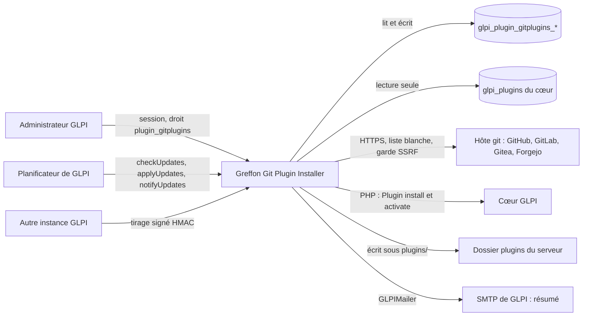
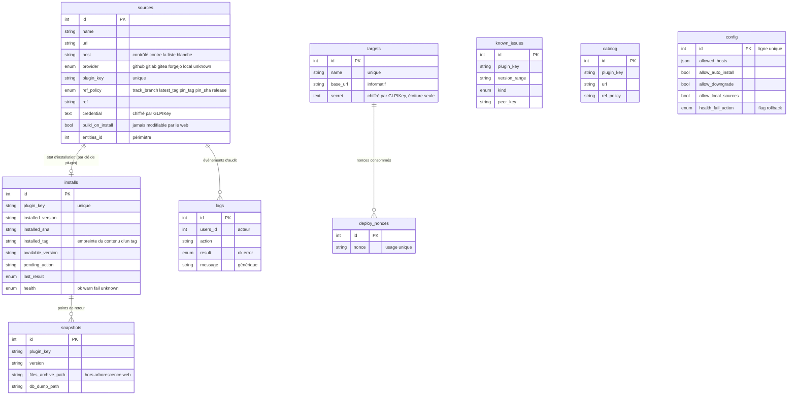

# Architecture — Git Plugin Installer

Document destiné au propriétaire et aux développeurs (plan inspiré d'arc42, vues du modèle C4).
Le modèle de données détaillé est dans [SCHEMA.md](SCHEMA.md) (en anglais) ; la sécurité dans
[SECURITE.md](SECURITE.md) ; les décisions dans [adr/](adr/).

## Objectifs et contraintes

- **Objectif** : installer et mettre à jour des greffons GLPI depuis une source git en HTTPS, de
  façon vérifiée et réversible, pour les greffons qui ne sont pas dans le catalogue officiel (dépôts
  privés ou auto-hébergés).
- **Contraintes** :
  - GLPI 11.0.x uniquement, PHP 8.2 ou plus, `declare(strict_types=1)` ;
  - le greffon **prolonge** le mécanisme natif : il ne réimplémente pas l'installation, il appelle
    `Plugin::install()` et `Plugin::activate()` du cœur, pour que les crochets du greffon cible
    s'exécutent ;
  - aucun binaire `git` : des archives en HTTPS seulement ([ADR 0001](adr/0001-archives-https-sans-binaire-git.md)) ;
  - le réseau, l'extraction et l'installation **ne se font jamais dans la requête web** : tâches
    automatiques reprenables ;
  - n'écrit que dans `glpi_plugin_gitplugins_*` (et ses droits dans `glpi_profilerights`), ne fait
    que lire `glpi_plugins` ;
  - `check_prerequisites()` n'appelle aucune classe du greffon ;
  - un seul expéditeur de courriel : celui du cœur (`Config::getEmailSender()`).
- **Hors périmètre** : vérifier une signature du code amont, désinstaller les greffons gérés, gérer
  les greffons du catalogue officiel (laissés à GLPI).

## Contexte



## Composants

| Composant | Fichier | Rôle |
|---|---|---|
| Source | `inc/source.class.php`, `front/source*.php` | objet métier : validation par le modèle (https, liste blanche, clé unique, jeton chiffré), accès par entité |
| Configuration | `inc/config.class.php`, `front/config.php` | ligne unique, bornes des réglages |
| Garde SSRF et téléchargement | `inc/fetcher.class.php`, `inc/httpclient.class.php` | HTTPS seul, liste blanche, adresses refusées, revalidation à chaque redirection, adresse épinglée |
| Résolution des références | `inc/refresolver.class.php`, `inc/updatecheck.class.php` | passe d'une politique (branche, tag, SHA, release) à une URL d'archive et à un SHA |
| Extraction | `inc/extractor.class.php` | format reconnu au contenu, chemins assainis, plafonds par entrée et au total, placement atomique, refus des liens symboliques |
| Installation | `inc/installer.class.php` | exécute la chaîne ; empreinte de contenu d'un tag ; appelle le cœur |
| Construction | `inc/builder.class.php` | `composer`/`npm` facultatifs, jamais activés par un formulaire |
| Contrôles | `inc/preflight.class.php`, `inc/health.class.php`, `inc/hookcheck.class.php`, `inc/knownissues.class.php` | environnement, santé après installation, collisions de crochets, problèmes connus |
| Sauvegarde et retour arrière | `inc/backup.class.php`, `inc/snapshot.class.php`, `inc/rollback.class.php` | archive inerte hors web, instantané des tables, restauration |
| Découverte | `inc/discovery.class.php` | greffons présents sur le disque et leur `<gitupdate>` |
| Plan groupé | `inc/planner.class.php`, `front/plan.php`, `front/bulk.php` | simulation puis mise en file |
| Catalogue | `inc/catalog.class.php`, `front/catalog.php` | manifestes JSON neutres |
| Source locale | `inc/localsource.class.php` | chemin du disque dans une liste blanche |
| Déploiement | `inc/deploy.class.php`, `inc/manifest.class.php`, `ajax/deploy.php`, `front/targets.php` | manifeste signé en mode tirage, anti-rejeu |
| Journal | `inc/log.class.php` | audit, conservation d'un an |
| Pages | `front/*.php`, `ajax/check.php`, `ajax/detect.php` | interface |
| Installation du greffon | `hook.php`, `setup.php` | tables, droit, tâches, champs chiffrés déclarés, route anonyme de `ajax/deploy.php` |

## Parcours principal

L'administrateur **examine** puis **met en file** ; la tâche automatique télécharge, extrait, place
et installe. Rien ne s'exécute avant la confirmation.

```mermaid
sequenceDiagram
    actor A as Administrateur
    participant F as front/install.php
    participant DB as glpi_plugin_gitplugins_*
    participant T as Tâche automatique
    participant G as Hôte git
    participant X as Extraction et placement
    participant C as Cœur GLPI

    A->>F: Examiner l'installation (POST, jeton CSRF)
    F->>G: résout la référence exacte et le SHA (garde SSRF)
    F-->>A: référence, SHA, versions, contrôle d'environnement, problèmes connus
    A->>F: Mettre en file (confirme la référence et le SHA examinés)
    F->>DB: action en attente, référence et SHA épinglés
    Note over T: toutes les heures et tous les quarts d'heure
    T->>DB: lit l'action en attente
    T->>T: tag déplacé ? clé valide ? géré par la marketplace ?
    T->>G: télécharge l'archive (plafonds, délai, adresse épinglée)
    T->>X: extrait dans un dossier temporaire, chemins assainis, plafonds
    X->>X: contrôle d'environnement, build facultatif, compilation des traductions
    X->>X: placement atomique ; l'ancienne version part en archive inerte hors du web
    X->>DB: instantané des tables du greffon cible
    T->>C: Plugin install puis activate
    T->>T: contrôle de santé ; restauration des fichiers et des tables en cas d'échec
    T->>DB: résultat, version installée, journal d'audit
```

## Modèle de données

Neuf tables, sans clé étrangère déclarée (convention GLPI : liens logiques, jointures en PHP). Détail
colonne par colonne : [SCHEMA.md](SCHEMA.md) (rédigé avant l'ajout des cinq dernières tables ; à
compléter).



## Déploiement

Le greffon vit dans `<glpi>/plugins/gitplugins/` et n'a aucun processus propre : ses pages sont servies
par GLPI, son travail est fait par les tâches automatiques du cron système de GLPI. Il écrit dans
`<glpi>/plugins/<clé>/` (placement atomique) et, hors de l'arborescence web, dans
`<GLPI_VAR_DIR>/_gitplugins/` (sauvegardes). La sortie réseau passe par le mandataire configuré dans
GLPI. En mode tirage, c'est l'instance **cible** qui contacte celle-ci, jamais l'inverse. Les trois
emplacements du greffon (source, production-test, Forgejo) sont décrits dans
[ADMINISTRATION.md](ADMINISTRATION.md#installation).

## Décisions

| ADR | Décision |
|---|---|
| [0001](adr/0001-archives-https-sans-binaire-git.md) | Télécharger des archives en HTTPS, sans binaire `git` |
| [0002](adr/0002-deploiement-en-mode-tirage.md) | Déployer vers d'autres instances en mode tirage, sans point d'entrée qui exécute du code |
| [0003](adr/0003-empreinte-d-un-tag-et-confiance-au-premier-usage.md) | Mémoriser le contenu d'un tag et refuser un tag déplacé ; pas de vérification de signature |

## Qualité et risques

- **Chaîne d'approvisionnement** : c'est le risque principal et il est assumé. Le greffon installe le
  code d'un tiers choisi par l'administrateur ; il réduit la surface (transport, archive, placement,
  tag déplacé, confirmation humaine, retour arrière) mais ne prouve pas l'authenticité du code. Voir
  [SECURITE.md](SECURITE.md).
- **Tests** : 290 tests, dont des mutations qui prouvent que chaque garde échoue quand on la retire
  (`tests/mutations/`).
- **Dette connue** : [SCHEMA.md](SCHEMA.md) est en retard ; le réglage d'installation automatique n'a
  pas de consommateur évident (voir [SECURITE.md](SECURITE.md#écarts-connus)).

## Glossaire

| Terme | English | Sens |
|---|---|---|
| Source | source | dépôt git déclaré, avec sa politique de référence |
| Politique de référence | ref policy | règle qui dit quelle version suivre : branche, dernier tag, tag ou SHA épinglé, release |
| Liste blanche des hôtes | allowed hosts | hôtes que le serveur a le droit de joindre |
| Instantané | snapshot | sauvegarde des fichiers et des tables avant une mise à jour |
| Retour arrière | rollback | restauration d'un instantané |
| Mode tirage | pull model | l'instance cible vient chercher le manifeste ; rien n'est poussé vers elle |
| Simulation | dry-run | aperçu qui ne modifie rien |
| Contrôle préalable | preflight | vérification de l'environnement avant installation |
