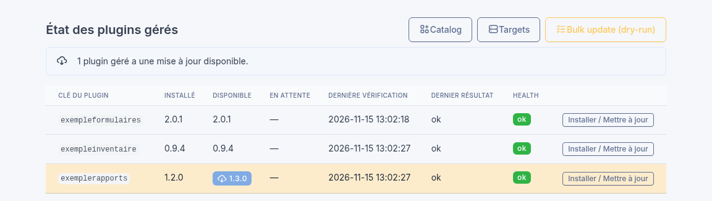
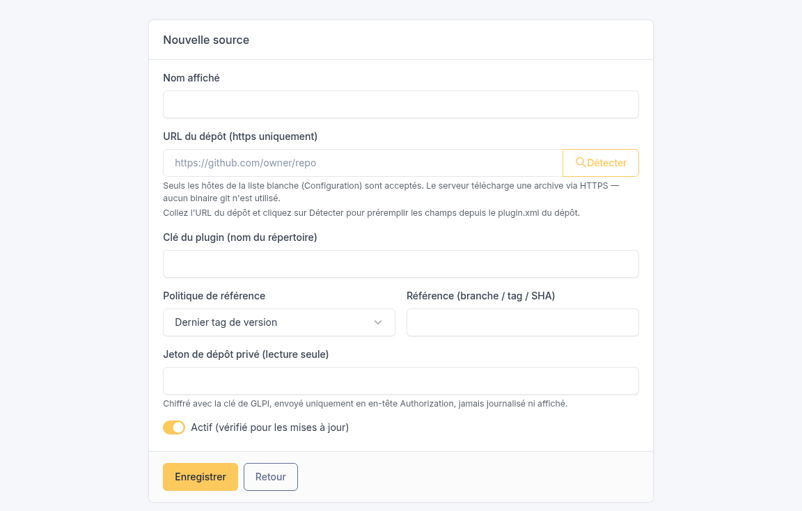
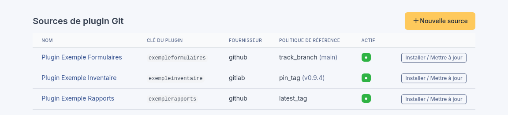
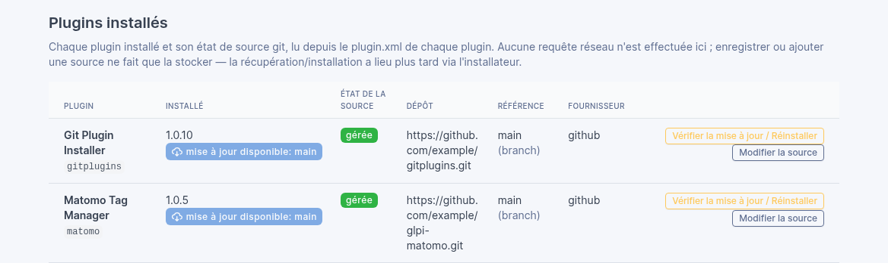
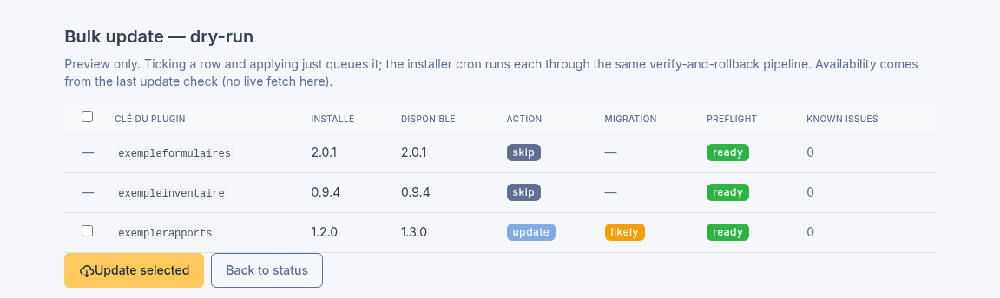

# User guide — Git Plugin Installer

[Français](GUIDE.md) · **English**

This guide explains how to carry out the common tasks. The complete manual (rights, automatic
actions, frequently asked questions) is [MANUEL.en.md](MANUEL.en.md). The menu is **Setup → Git Plugin
Installer**; it only appears if your profile has the `plugin_gitplugins` right. Installing a plugin
runs its install code on the server: only confirm trusted sources. Three buttons of the **Status**
screen (**Catalog**, **Targets**, **Bulk update (dry-run)**) and the **Rollback** button are displayed
in English whatever the interface language.

## Getting to know the main screen

The **Status** screen is the starting point: one row per managed plugin.

At the top right, three buttons lead to the advanced screens: **Catalog**, **Targets** and **Bulk
update (dry-run)**. The table gives the **Plugin key**, the **Installed** version, the **Available**
version, the **Pending** action, the **Last check**, the **Last result** and the health state
(*Health*). A yellow row and a banner flag an available update.

## Adding a source

Declare a git repository whose versions the plugin will follow.

1. Open **Sources**, then click **New source**.
2. Paste the **Repository URL (https only)** and click **Detect**: the fields are pre-filled from the
   repository's `plugin.xml`. If detection fails, fill them in by hand.
3. Check the **Display name** and the **Plugin key (directory name)**: lowercase letters, digits and
   underscore.
4. Choose the **Ref policy**: **Latest release tag**, **Track a branch**, **Pin to a tag**, **Pin to a
   commit SHA** or **Latest built release (.tgz asset)**. For a branch, a tag or a SHA, fill in **Ref
   (branch / tag / SHA)**.
5. For a private repository, enter the **Private-repo token (read-only)**: it is encrypted and never
   displayed again. Leave the field empty to keep the stored token.
6. Leave **Active (checked for updates)** on, then click **Save**.

**Result:** "Source created." is displayed; the plugin appears in **Sources** and in **Status**.

An error message states the cause: a URL that is not https, a host missing from the allowed-hosts
list, a key already managed by another source, or a plugin managed by the GLPI marketplace.

## Registering an already installed plugin

Bring a plugin that is already on disk under management.

1. Open **Installed plugins**. Each plugin has a source state: **managed**, **declared**,
   **marketplace** or **no source**.
2. For a "declared" plugin (it announces its own repository), click **Register as managed source**.
   For a plugin with no source, click **Add source**.
3. If the repository is private, open the source (**Edit source**) and add the token.

**Result:** "Source registered as managed."; no download takes place at this stage.

## Checking the status and spotting an update

Know which plugins are up to date.

1. Open **Status**.
2. Read the table: a yellow row indicates an available update, the banner at the top gives the count.
3. Hover over the additional badges (hook conflicts with other plugins, "known issues") for details.

**Result:** you know which plugins are up to date. The screen does not query the Internet: it shows
the result of the last automatic check.

## Installing or updating a plugin

Move a plugin to the version its source offers.

1. In **Sources** or **Status**, click **Install / Update** next to the plugin.
2. Click **Review install / update**: the plugin contacts the source and displays the exact ref, the
   commit SHA, the installed version, the available version, the environment check (**Environment
   preflight**: ready or blocked), the known issues and the changelog between the two versions.
3. If the check says "blocked", do not continue: note the reasons shown.
4. Read the warning, then click **Queue install / update** and confirm.

**Result:** "Queued. The installer cron will fetch and install it on its next run." The installation
is therefore not immediate: follow it in **Status** (**Pending** and **Last result** columns). Special
cases: "Already up to date — nothing to install.", "Refused: the available version is older…"
(downgrade not allowed), "The source moved since you reviewed it" (start the review again).

## Updating several plugins at once

Apply all the updates after previewing them.

1. In **Status**, click **Bulk update (dry-run)**.
2. The table is a preview: for each plugin, the planned action, a likely migration, the preflight and
   the number of known issues.
3. Tick the rows you want (or the header box), click **Update selected** and confirm.

**Result:** a message announces the number of plugins queued; the automatic action then applies them
one by one.

## Rolling back to a previous version

Undo an update that went wrong.

1. In **Status**, find the plugin's row: a dropdown list of backups (version and date) appears if any
   exist.
2. Choose the backup, click **Rollback** and confirm.

**Result:** "Rolled back to the selected snapshot." The plugin's code and tables are replaced. If it
fails, the plugin stays as it is and an error message is displayed.

## Removing a source

Stop following a repository, without uninstalling the plugin.

1. Open the source (**Sources**, then its name), click **Remove** and confirm.

**Result:** "Source removed from management." The installed plugin is **not** uninstalled. This
action requires the delete (purge) right.

## Frequently asked questions

| Question | Answer |
|---|---|
| Why does nothing happen after I queue an install? | The install waits for the automatic action (up to fifteen minutes or an hour); if **Pending** does not change, check GLPI's cron (see [ADMINISTRATION.en.md](ADMINISTRATION.en.md#troubleshooting)). |
| Can I manage a plugin from the official marketplace? | No: update it from GLPI's marketplace. |
| Where are the catalog and the deploy targets? | The **Catalog** and **Targets** buttons of the **Status** screen; see [MANUEL.en.md](MANUEL.en.md). |
