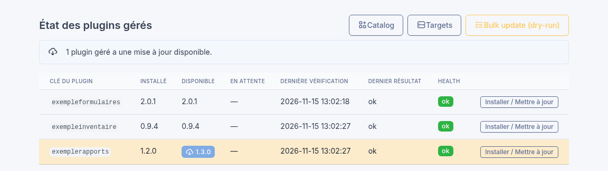
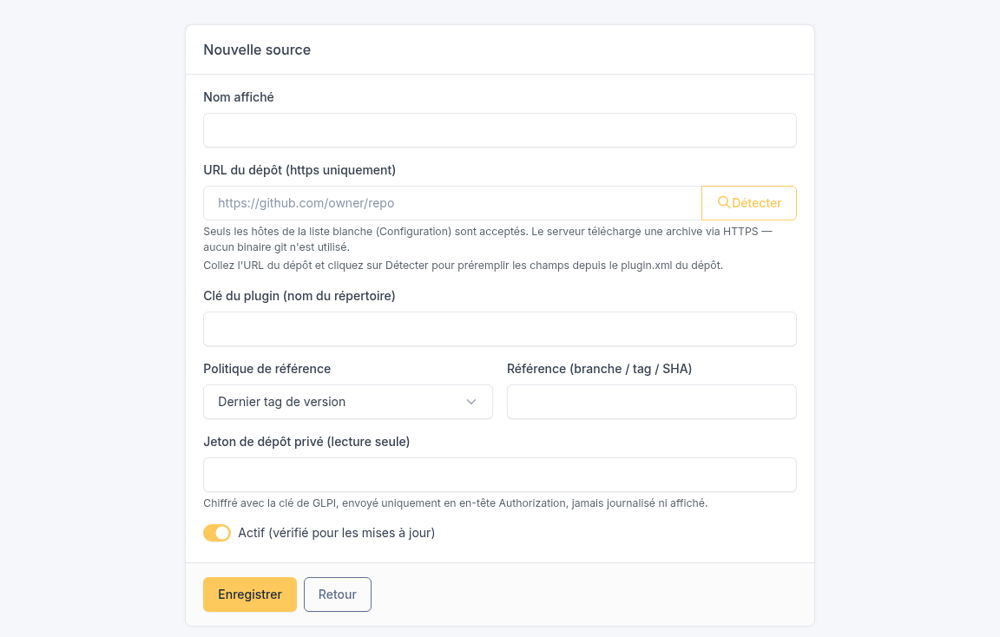
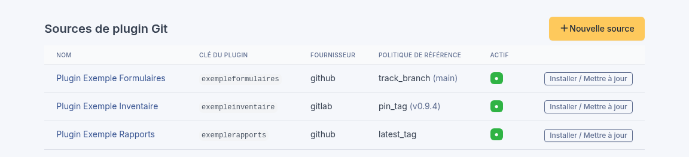
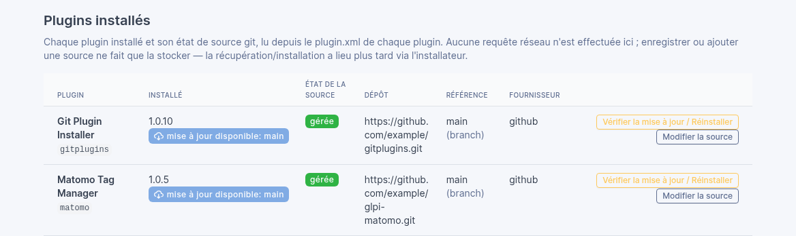
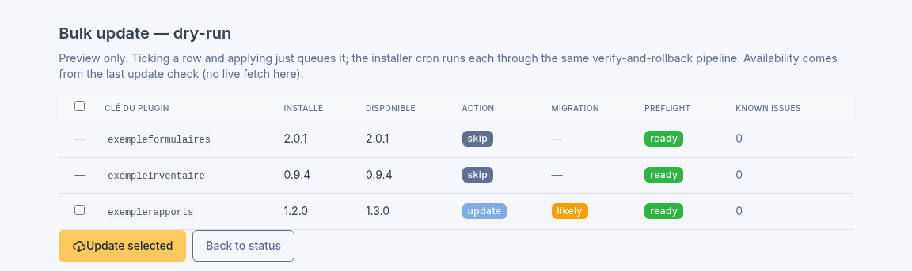

# Guide d'utilisation — Git Plugin Installer

**Français** · [English](GUIDE.en.md)

Ce guide dit comment accomplir les tâches courantes. Le manuel complet (droits, tâches automatiques,
questions fréquentes) est dans [MANUEL.md](MANUEL.md). Dans l'interface française, le greffon
s'appelle **Installateur de plugins Git** et son menu est **Configuration → Installateur de plugins
Git** ; il n'apparaît que si votre profil a le droit `plugin_gitplugins`. Installer un plugin exécute
son code d'installation sur le serveur : ne confirmez que des sources de confiance. Trois boutons de
l'écran **État** (**Catalog**, **Targets**, **Bulk update (dry-run)**) et le bouton **Rollback** restent
affichés en anglais.

## Découvrir l'écran principal

L'écran **État** est le point de départ : une ligne par plugin géré.

En haut à droite, trois boutons mènent aux écrans avancés : **Catalog**, **Targets** et **Bulk update
(dry-run)**. Le tableau donne la **Clé du plugin**, la version **Installé**, la version **Disponible**,
l'action **En attente**, la **Dernière vérification**, le **Dernier résultat** et l'état de santé
(*Health*). Une ligne jaune et un bandeau signalent une mise à jour disponible.

## Ajouter une source

Déclarer un dépôt git dont le greffon suivra les versions.

1. Ouvrez **Sources**, puis cliquez sur **Nouvelle source**.
2. Collez l'**URL du dépôt (https uniquement)** et cliquez sur **Détecter** : les champs se préremplissent
   depuis le `plugin.xml` du dépôt. Si la détection échoue, remplissez-les à la main.
3. Vérifiez le **Nom affiché** et la **Clé du plugin (nom du répertoire)** : minuscules, chiffres et
   tiret bas.
4. Choisissez la **Politique de référence** : **Dernier tag de version**, **Suivre une branche**,
   **Épingler à un tag**, **Épingler à un SHA de commit** ou **Dernière release pré-compilée (asset
   .tgz)**. Pour une branche, un tag ou un SHA, renseignez **Référence (branche / tag / SHA)**.
5. Pour un dépôt privé, saisissez le **Jeton de dépôt privé (lecture seule)** : il est chiffré et
   plus jamais affiché. Laissez le champ vide pour conserver le jeton enregistré.
6. Laissez **Actif (vérifié pour les mises à jour)** activé, puis cliquez sur **Enregistrer**.

**Résultat :** « Source créée. » s'affiche ; le plugin apparaît dans **Sources** et dans **État**.

Un message d'erreur en donne la cause : URL qui n'est pas en https, hôte absent de la liste des hôtes
autorisés, clé déjà gérée par une autre source, ou plugin géré par la marketplace de GLPI.

## Enregistrer un plugin déjà installé

Reprendre sous gestion un plugin déjà présent sur le disque.

1. Ouvrez **Plugins installés**. Chaque plugin a un état de source : **gérée**, **déclarée**,
   **marketplace** ou **aucune source**.
2. Pour un plugin « déclaré » (il annonce son propre dépôt), cliquez sur **Enregistrer comme source
   gérée**. Pour un plugin sans source, cliquez sur **Ajouter une source**.
3. Si le dépôt est privé, ouvrez la source (**Modifier la source**) et ajoutez le jeton.

**Résultat :** « Source enregistrée comme gérée. » ; aucun téléchargement n'a lieu à ce stade.

## Consulter l'état et repérer une mise à jour

Savoir quels plugins sont à jour.

1. Ouvrez **État**.
2. Lisez le tableau : une ligne jaune indique une mise à jour disponible, le bandeau du haut en
   donne le nombre.
3. Survolez les pastilles supplémentaires (conflits de crochets avec d'autres plugins, « problèmes
   connus ») pour le détail.

**Résultat :** vous savez quels plugins sont à jour. L'écran n'interroge pas Internet : il montre le
résultat de la dernière vérification automatique.

## Installer ou mettre à jour un plugin

Faire passer un plugin à la version proposée par sa source.

1. Dans **Sources** ou **État**, cliquez sur **Installer / Mettre à jour** en face du plugin.
2. Cliquez sur **Examiner l'installation / la mise à jour** : le greffon interroge la source et
   affiche la référence exacte, le SHA de commit, la version installée, la version disponible, le
   contrôle d'environnement (*Environment preflight* : prêt ou bloqué), les problèmes connus et le
   journal des modifications entre les deux versions.
3. Si le contrôle indique « blocked », ne poursuivez pas : notez les motifs affichés.
4. Lisez l'avertissement, puis cliquez sur **Mettre en file l'installation / mise à jour** et
   confirmez.

**Résultat :** « Mis en file. La tâche planifiée d'installation le téléchargera et l'installera lors de
sa prochaine exécution. » L'installation n'est donc pas immédiate : suivez-la dans **État** (colonnes
**En attente** et **Dernier résultat**). Cas particuliers : « Déjà à jour — rien à installer. », « Refusé :
la version disponible est plus ancienne… » (rétrogradation interdite), « La source a changé depuis
votre relecture » (recommencez l'examen).

## Mettre à jour plusieurs plugins d'un coup

Appliquer toutes les mises à jour après les avoir prévisualisées.

1. Dans **État**, cliquez sur **Bulk update (dry-run)**.
2. Le tableau est une simulation : pour chaque plugin, l'action prévue, une migration probable, le
   contrôle préalable (*Preflight*) et le nombre de problèmes connus.
3. Cochez les lignes voulues (ou la case d'en-tête), cliquez sur **Update selected** et confirmez.

**Résultat :** un message annonce le nombre de plugins mis en file ; la tâche automatique les applique
un par un.

## Revenir à une version précédente

Annuler une mise à jour qui s'est mal passée.

1. Dans **État**, repérez la ligne du plugin : une liste déroulante de sauvegardes (version et date)
   apparaît s'il en existe.
2. Choisissez la sauvegarde, cliquez sur **Rollback** et confirmez.

**Résultat :** « Rolled back to the selected snapshot. » (affiché en anglais). Le code et les tables du
plugin sont remplacés. En cas d'échec, le plugin reste tel quel et un message d'erreur s'affiche.

## Retirer une source

Cesser de suivre un dépôt, sans désinstaller le plugin.

1. Ouvrez la source (**Sources**, puis son nom), cliquez sur **Retirer** et confirmez.

**Résultat :** « Source retirée de la gestion. » Le plugin installé n'est **pas** désinstallé. Cette
action exige le droit de suppression (purge).

## Questions fréquentes

| Question | Réponse |
|---|---|
| Pourquoi ma mise en file ne produit-elle rien ? | L'installation attend la tâche automatique (jusqu'à quinze minutes ou une heure) ; si **En attente** ne bouge pas, vérifiez le cron de GLPI (voir [ADMINISTRATION.md](ADMINISTRATION.md#dépannage)). |
| Puis-je gérer un plugin du catalogue officiel ? | Non : mettez-le à jour depuis la marketplace de GLPI. |
| Où trouver le catalogue et les cibles de déploiement ? | Boutons **Catalog** et **Targets** de l'écran **État** ; voir [MANUEL.md](MANUEL.md). |
